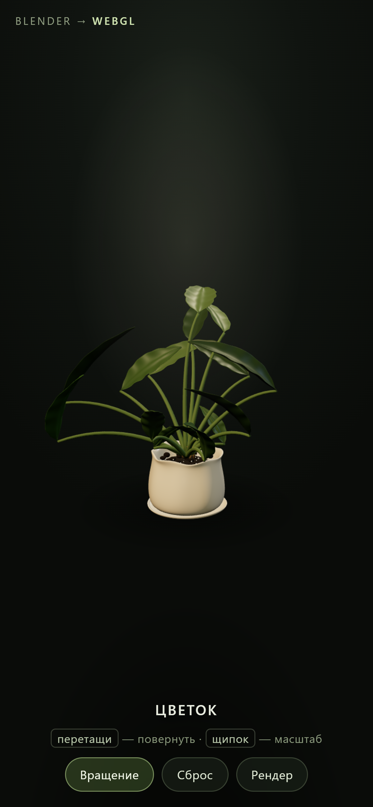

# Цветок — 3D в браузере

Комнатное растение, собранное процедурно в Blender 4.2 и показанное в вебе: интерактивная
модель на Three.js + финальный рендер Cycles.

🔗 **Живая демонстрация:** https://smhotey.github.io/flower-3d/

## Что внутри

| Файл | Что это |
|---|---|
| `index.html` | вся страница: вьювер, свет, жесты, переключатель «Рендер» |
| `plant.glb` | модель растения (116 объектов, ~203 тыс. треугольников, Draco) |
| `flower.jpg` | финальный рендер 1200×1500 из Blender |

Модель весит 570 КБ вместо исходных 3.8 МБ: сжатие Draco (уровень 6) и один уровень
сабдива вместо двух. Страница целиком — около 670 КБ, грузится на телефоне за секунды.

## Управление

- перетаскивание — поворот камеры с инерцией
- щипок двумя пальцами (или колесо) — масштаб
- кнопка **Вращение** — авто-поворот, **Сброс** — исходный кадр, **Рендер** — статичное фото

## Как собрано

1. `blender-flower/flower_scene.py` — процедурная сцена: горшок как тело вращения с
   фестончатым краем, 15 листьев (V-образный изгиб, рёбро жилки, скручивание, провисание,
   шумовая деформация), грунт с керамзитом, три источника света, камера с ГРИПом.
2. `flower_final_v3.png` — Cycles на CPU, 1200×1500, 56 сэмплов, 6 мин 17 с.
3. `export_glb_web.py` — облегчение и экспорт: сабдив 1, Draco 6, **плоские базовые цвета**
   (процедурные ноды glTF не переносит, иначе листья уезжают в белый).
4. `index.html` — Three.js r160, OrbitControls, DRACOLoader, вписывание камеры по габаритам
   модели с учётом радиуса вращения.

## Особенности реализации страницы

- камера вписывает модель по горизонтальному **и** вертикальному FOV — на портретном экране
  ограничителем становится ширина, поэтому считается радиус описанного цилиндра, а не ширина
  текущего ракурса (иначе при вращении листья выходят за кадр)
- `touch-action: none` + явные `width/height: 100%` у canvas
- контактная тень — процедурная canvas-текстура, без карт теней (дешево для телефона)
- пауза рендера при скрытой вкладке, `devicePixelRatio` до 2×
- если WebGL или CDN недоступны — открывается статичный рендер

## Лицензия

MIT
